<p align="center">
  
</p>

<h1 align="center">JavJaeger</h1>

<p align="center">
  <strong>发现影片，整理收藏，在网页与电视上观看。</strong><br>
  影片检索 · 下载派发 · 刮削整理 · 私有影视库 · 网页影院 · Android TV
</p>

<p align="center">
  <a href="#许可证"></a>
  <a href="https://github.com/cnlutong/JavJaeger/releases/tag/android-tv-v0.3.5"></a>
</p>

<p align="center">
  <a href="#功能一览">功能一览</a> ·
  <a href="#快速开始">快速开始</a> ·
  <a href="#网页影院与海报浏览">网页影院</a> ·
  <a href="#android-tv在电视上观看">Android TV</a> ·
  <a href="https://github.com/cnlutong/JavJaeger/releases/tag/android-tv-v0.3.5"><strong>下载 APK</strong></a>
</p>

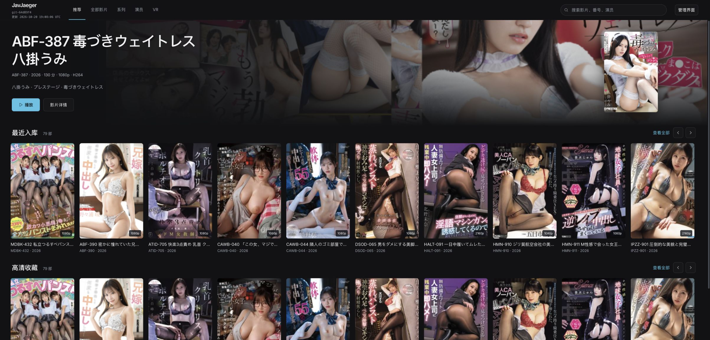

<p align="center"><sub>网页影院实拍 · 精选影片 / 最近入库 / 高清收藏</sub></p>

JavJaeger 是面向个人收藏与私有部署的 JAV 影片管理与自动化工具。你可以从影片检索开始，把资源派发到 PikPak、115 网盘或 Aria2，再刮削整理到本地影视库；也可以直接扫描已有收藏，通过**网页影院或原生 Android TV 客户端**浏览和播放。

<details>
<summary>关于页面截图</summary>

本文的 **25 张截图均取自实际部署的网页端**，摄于 **2026-10-21**，部署版本为 **git-64d89f4**；部分界面与当前仓库版本有所差异。Android TV 的安装和功能另见[电视端使用指南](#android-tv在电视上观看)。

</details>

## 功能一览

| 使用场景 | 入口 | 主要功能 |
| --- | --- | --- |
| 发现、下载与播放影片 | 浏览 | JavBus 横版封面瀑布流，演员、标签等组合筛选，派发到 PikPak、115 或 Aria2，也可等待 115 离线完成后播放 |
| 浏览与播放本地收藏 | 影院模式 | 推荐、全部影片、标签、演员与 VR 分区；海报墙、组合筛选、排序、详情和分段播放 |
| 在电视上观看 | Android TV 客户端 | 原生电视界面，使用遥控器浏览同一影视库、搜索筛选、查看详情和播放 |
| 管理已有收藏 | 影视库 | 扫描多个媒体目录，以海报、演员或列表视图浏览，检查与补全资料，管理本地文件 |
| 整理下载好的文件 | 本地刮削 | 识别番号、抓取资料、下载封面与头像、写入 NFO，预览后按命名规则整理文件 |
| 查找影片和资源 | 影片检索 | 按番号、演员、类别、制作商、发行商、导演或系列检索，查询磁力，从页面 HTML 识别影片 |
| 从论坛发现影片 | 论坛影片 | 98 堂分区图文列表、标题与 LTX 关键词筛选，使用原帖磁力向网盘或 Aria2 单条、批量下发 |
| 将资源交给下载工具 | 下载派发 | 单片、批量番号或检索结果派发至 PikPak、115 网盘或 Aria2，支持历史去重与失败重试 |
| 浏览与管理网盘文件 | 网盘与下载 | 浏览 WebDAV、115 网盘及服务端本地目录，将远程文件或文件夹发送给 Aria2，单项或批量删除 115 文件与文件夹，管理下载任务 |
| 按计划发现和派发 | 自动模式 | 保存“触发 → 检索 → 磁力 → 下载”流程，手动运行、每天定时或按分钟间隔运行 |
| 减少媒体占用 | 转码 | 使用 GPU 转码，查看进度、取消或重试；校验通过且输出更小时才替换原片 |
| 调整连接与浏览体验 | 设置 | 配置媒体目录、刮削来源和下载工具，切换管理界面主题，管理资料与图片缓存 |

## 快速开始

已有服务器时，直接打开网页并配置媒体目录；电视端用户可跳到 [Android TV 安装与使用](#android-tv在电视上观看)。

### 部署服务器

<details>
<summary>展开 Docker 部署步骤</summary>

服务器需要安装 Git、Docker 和 Compose。下面在仓库根目录操作，应用默认通过宿主机 `8000` 端口访问。

```bash
git clone https://github.com/cnlutong/JavJaeger.git
cd JavJaeger
openssl rand -hex 32
```

把最后一条命令生成的随机值，**手工替换**到 `docker-compose.yml` 中现有的 `APP_SESSION_SECRET=change-this-session-secret`。该文件目前直接写入密钥值，仅在 `.env` 中定义同名变量不会替换它。

需要管理本地媒体时，在 `javjaeger` 服务已有的 `volumes` 列表中追加媒体挂载。以下左侧是宿主机目录，按实际位置修改；保留原有的 `./data` 和 `./actor_images` 挂载。

```yaml
      - /srv/downloads:/media/inbox
      - /srv/media/jav:/media/library
```

待刮削目录和影视库目录需要允许应用写入，转码还需要在源文件所在磁盘保留临时输出空间。准备好目录后启动：

```bash
docker compose up -d --build
docker compose logs --tail=100 javjaeger
```

在服务器本机打开 [http://localhost:8000](http://localhost:8000)；其他设备使用服务器的 IP 或域名及 `8000` 端口。使用旧版 Compose 时，将命令中的 `docker compose` 换成 `docker-compose`。

应用适合放在可信的私有网络中使用，没有独立的多用户登录体系。需要从公网访问时，先按 [Docker 部署指南](DOCKER.md) 配置反向代理与访问控制。

</details>

### 配置媒体与下载工具

1. 打开 **设置 → 媒体目录**。按部署示例，将待刮削目录设为 `/media/inbox`，影视库目录设为 `/media/library`。
2. 如有多个影视库目录或排除目录，进入 **影视库 → 路径配置** 添加。第一项影视库目录是默认刮削输出目录。
3. 需要下载时，在 **设置** 中配置 PikPak、115 网盘或 Aria2；仅浏览已有收藏时可以跳过。
4. 需要检索或刮削时，在 **设置 → JavBus API** 检查站点地址和代理，在 **刮削源** 启用所需来源，先保存，再测试连接。

页面填写的路径必须是**服务器进程能访问的路径**。Docker 中填写 `/media/library` 这类容器路径；待刮削目录与影视库目录不能相同，影视库也不能放在待刮削目录里面。保存目录不会自动扫描或移动文件。

### 按你的情况开始

| 当前情况 | 使用顺序 |
| --- | --- |
| 已有本地收藏 | [扫描影视库](#影视库扫描与管理) → 检查并补全资料 → 通过[网页影院](#网页影院与海报浏览)或 [Android TV](#android-tv在电视上观看) 播放 |
| 从寻找资源开始 | [影片检索与下载派发](#影片检索与下载派发) → 在下载工具中确认下载完成 → 通过[本地刮削](#本地刮削整理媒体文件)生成预览并执行 → 浏览影视库 |

<details>
<summary>查看设置页面、主题与缓存管理</summary>

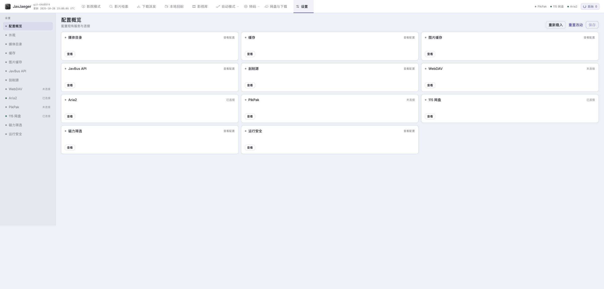

*设置页集中管理媒体目录、下载工具与刮削来源。*

**设置 → 外观** 可切换管理界面的浅色或深色主题；影院保持独立暗色。

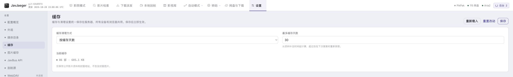

*资料缓存可按保留天数或容量清理。*

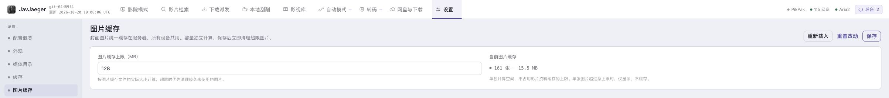

*图片缓存有独立容量上限，服务端缓存可供不同设备共用。*

</details>

## 网页影院与海报浏览

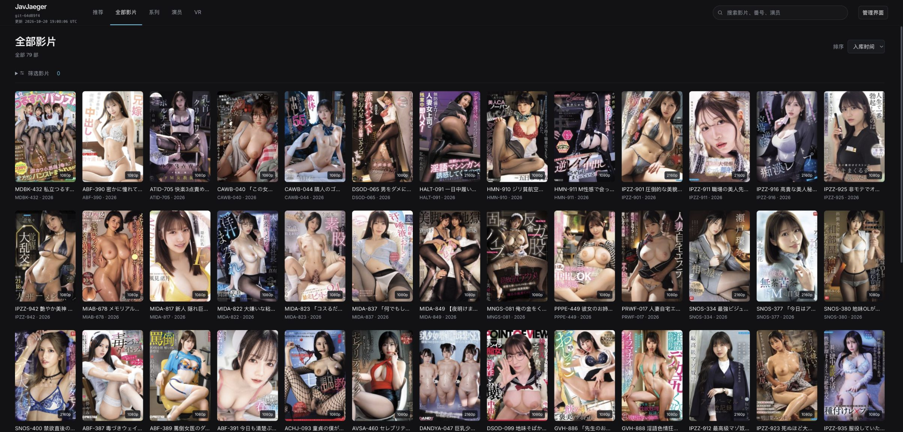

*全部影片海报墙，可搜索、组合筛选与排序。*

影院使用本地影视库资料，提供 **推荐、全部影片、标签、演员、VR** 导航。推荐页按收藏内容展示最近入库、高清收藏与 VR 分区；标签页显示实际标签和对应影片数量，演员页可进入个人影片墙。

1. 从推荐或海报墙打开影片，也可搜索标题、番号或演员。
2. 展开筛选，组合演员、制作商、分辨率和标签，再选择排序方式。
3. 标签可选择“匹配任一标签”或“匹配全部标签”；不同筛选组之间需要同时满足。
4. 打开详情，选择本地文件播放。多段影片可切换文件，并在播放结束后继续后续可用分段。

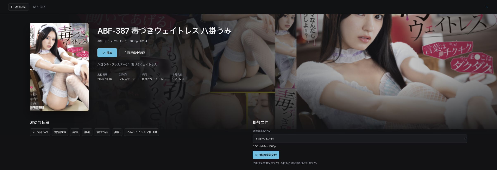

*影片详情与本地播放文件选择。*

关闭详情后保留浏览位置。影院直接播放服务器上的原文件，编码和音轨能否使用取决于浏览器；无法播放时，可先从影片详情创建硬件转码任务。当前没有实时转码或跨设备观看进度。

影院和影视库播放支持原片旁的 SRT/VTT 外挂字幕。字幕与视频保持相同文件名，可附加语言标记，例如 `ABF-017.mp4` 对应 `ABF-017.zh-Hans.srt` 或 `ABF-017.zh-Hans.vtt`；编码使用 UTF-8 或带 BOM 的 UTF-16。播放时自动读取，优先加载中文字幕，无需重新扫描影视库。播放器上方的“字幕”可选择语言或关闭，切换字幕不会重启视频；多段影片分别读取各自的字幕。同名 SRT/VTT 优先使用 VTT，仅显示一条。字幕需要预先生成，本功能不在播放时运行识别模型。

同目录存在同名的不同视频版本时，可保留视频扩展名区分字幕，例如 `SNOS-377.mp4.zh-Hans.srt` 与 `SNOS-377.mkv.zh-Hans.srt`。播放时只读取对应版本的字幕；同一语言优先使用版本专属字幕，再使用不含视频扩展名的通用字幕。

展开“字幕样式”可设置字体、四档字号与底部留白，默认留白为 4%，数值越小字幕越靠下。调整即时生效，保存在当前浏览器，重新播放和刷新页面后沿用；可选择“恢复默认”。网页和 TV 分别保存各自的显示偏好。

<details>
<summary>查看影院精选、搜索、组合筛选、演员与系列</summary>

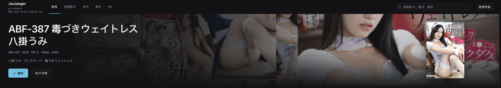

*影院模式的头部精选区域。*

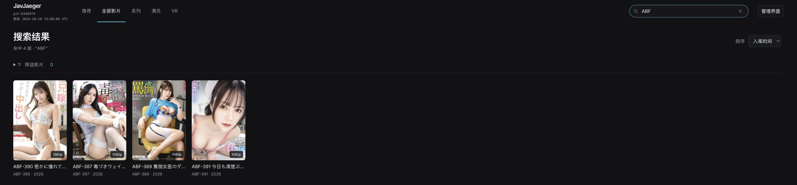

*影院中搜索 ABF，展示本地影视库命中的 4 部影片。*

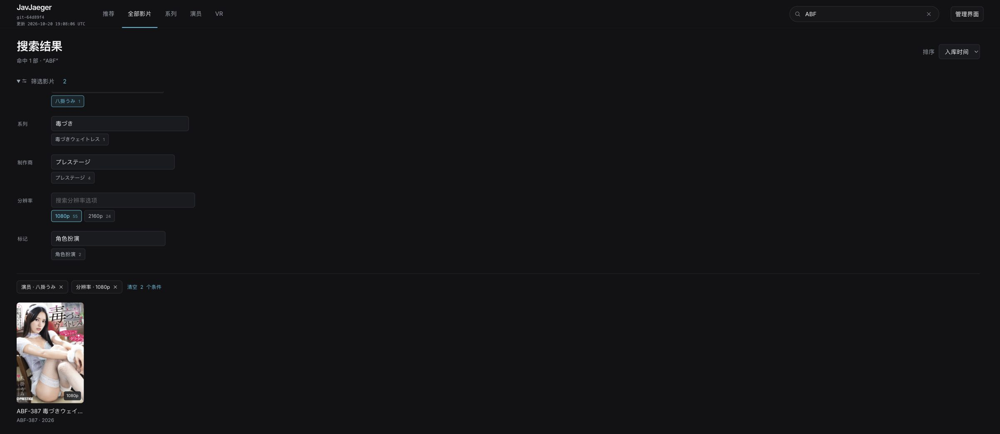

*ABF 搜索叠加演员“八掛うみ”和 1080p 条件后命中 1 部影片。*

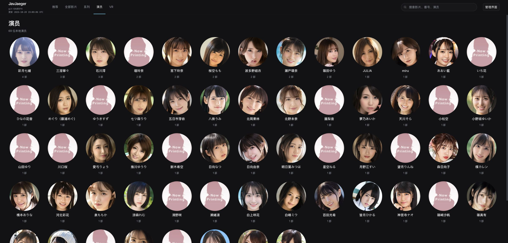

*演员目录，可进入演员关联的影片墙。*

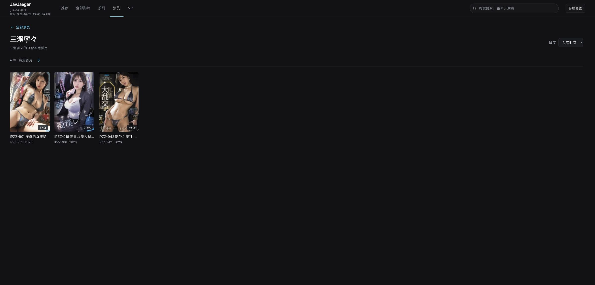

*从演员目录进入“三澄寧々”，浏览关联的 3 部影片。*

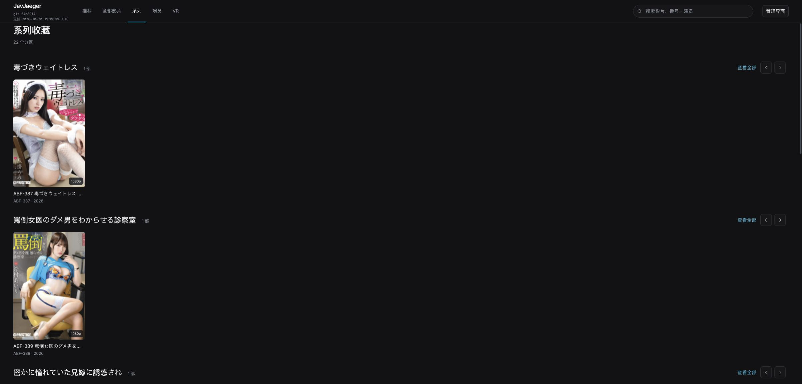

*部署版“系列”入口共 22 个分区，图中为首屏前两个横排；当前仓库使用标签入口。*

</details>

## 浏览：发现、下载与播放影片

从管理界面或影院进入 **浏览**，也可直接打开 `/#browse`。页面按 JavBus 的分页展示完整横版封面，演员、标签、制作商等条件可以组合使用；组合筛选可能产生空页，仍可继续加载下一页。

需要下载时，在顶部选择 **下载目标**（PikPak、115 网盘或 Aria2），确认已连接；点击卡片或详情中的 **下载**，核对番号和目标后开始派发。未连接时会打开现有下载工具配置。服务端自动检索并选择最佳磁力，复用下载历史去重与后台任务；进度和结果在 **后台** 查看，失败项可到 **下载派发** 页重试。“已提交”表示工具接受任务，下载完成情况需在对应工具中确认。

需要通过 115 播放时：

1. 在 **设置 → 115 网盘** 登录有效账号，并按需设置离线目录 CID。
2. 在浏览页选择筛选条件，打开影片详情，点击播放。
3. 服务端按现有最佳磁力规则选择资源，提交到 115；已有的对应离线任务会继续等待，避免重复提交。
4. 等待下载完成并找到视频后，页面打开播放器。浏览器限制自动播放时，点击播放器中的播放按钮。

等待任务按浏览器会话隔离，刷新页面后可以继续查看；取消等待不会删除网盘文件或取消已提交的 115 下载。失败或等待超过 30 分钟时可查看提示并重试。临时任务不跨服务重启恢复。

视频经 JavJaeger 服务器转发，Cookie 和网盘临时直链不会发送给浏览器；服务器需要能够访问 115 下载节点，并承担播放流量。播放器使用原始视频，编码和音轨支持取决于浏览器；此流程没有实时转码。

## Android TV：在电视上观看

JavJaeger TV 是独立的原生 Android TV 客户端，与网页影院连接同一个 JavJaeger 服务器，共用服务器影视库。支持 **Android 6.0 及以上 Android TV**，使用遥控器方向键、确认键和返回键操作。

**[下载 JavJaeger TV v0.3.5 测试版 APK](https://github.com/cnlutong/JavJaeger/releases/tag/android-tv-v0.3.5)** · [完整电视端说明](android-tv/README.md)

沿用旧版签名，已有测试版可直接覆盖升级。新片的 115 播放需要 v0.3.0 及以上服务端；外挂字幕需要部署包含字幕接口的新服务端。

### 安装与连接

1. 先在服务器管理网页中配置媒体目录，扫描影视库并补全封面和资料。
2. 下载 APK，复制到电视后通过文件管理器安装，从应用列表打开 **JavJaeger TV**。当前发布包使用调试签名，适合自用安装和测试。
3. 输入电视可访问的服务器地址，例如 `http://192.168.1.100:8000`，选择 **连接服务器**。不要填写电视自身的 `localhost`、媒体文件路径或网盘地址。
4. 使用遥控器浏览海报，按标题、番号或演员搜索；打开详情，选择本地文件开始播放。

### 电视端可以做什么

- 浏览推荐、全部影片、标签、演员和 VR；从演员或标签进入对应影片列表。
- “浏览新片”支持与网页浏览页相同的 JavBus 目录、组合筛选、详情和 115 等待播放。
- 组合演员、制作商、分辨率和标签条件，按入库时间、发行日期、体积或番号排序。
- 暂停、继续、定位进度、切换文件和停止播放；多段影片顺序播放后续可用文件。
- 自动加载原片旁的 SRT/VTT 字幕，优先中文字幕；遥控器开关字幕，并配置字体、字号和底部留白，设置保存在当前设备。
- 返回详情或浏览页时保留搜索、筛选和浏览位置；管理入口通过系统浏览器打开服务器管理页，没有浏览器时显示可在其他设备访问的地址。

电视端使用随焦点收起或展开的侧栏，将搜索、组合筛选与排序改为按需打开。影片封面按实际比例完整显示：推荐横排固定图片高度并调整卡片宽度，影片墙按等宽列排布不同高度的封面，演员目录末行保持固定列宽。详情使用封面与播放资料双栏。播放器控件叠加在视频上并自动隐藏；从顶部操作栏按下键进入进度条，左右键每次定位 10 秒，按确认键提交，也支持鼠标或触控拖动。刷新、服务器连接和管理入口位于“更多”。

电视端保存不含凭据的服务器地址和字幕显示偏好，下载、刮削和媒体整理在服务端完成。视频直接播放原文件，支持 Range 跳转；停止、换片或跳转使旧连接断开时，服务器会停止旧响应的后续读取并关闭文件。编码和内封音轨支持取决于电视；当前没有实时转码或跨设备观看进度。不支持的编码可先在服务器管理网页中转码。

电视需要能直接访问服务器。带登录的反向代理需要另行适配，连接与安装排障见 [Android TV 说明](android-tv/README.md)。

## 影视库：扫描与管理


*影视库海报模式，用封面浏览本地收藏。*

### 扫描与补全资料

1. 在 **影视库 → 路径配置** 添加媒体目录，并配置需要跳过的目录。
2. 选择一个路径扫描，或扫描全部影视库目录；待刮削目录会自动排除。
3. 扫描会导入视频及同名 NFO 中的资料，建立影片和演员索引。
4. 使用资料检查查找缺失标题、演员、标签、NFO 或封面，再对需要的影片补全资料。

列表、海报和演员视图用于不同的浏览方式。可按番号、标题等搜索，按演员、制作商、影片类型等筛选；详情中可以查看登记的本地文件、媒体参数并播放或创建转码任务。

**刷新影视库只重新读取索引，不重新扫描硬盘。** 在应用外增删或移动了文件后，重新扫描相应目录；需要核验已登记文件是否存在时，可运行资料检查。

<details>
<summary>查看影视库海报筛选、演员、列表与影片详情</summary>

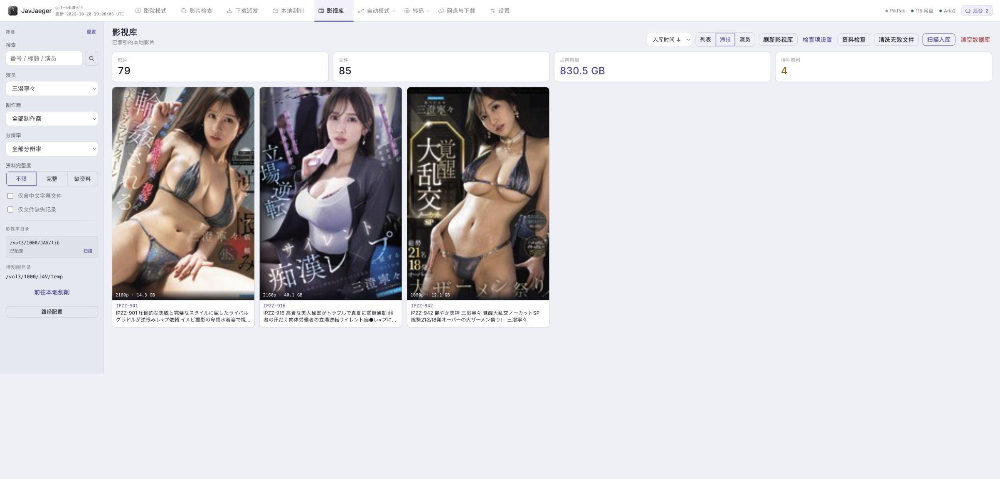

*选择演员“三澄寧々”，海报模式显示关联的 3 部影片。*

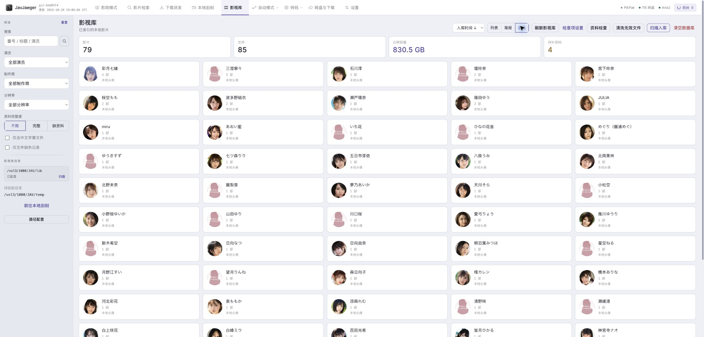

*本地影视库的演员视图，可进入演员关联的影片列表。*

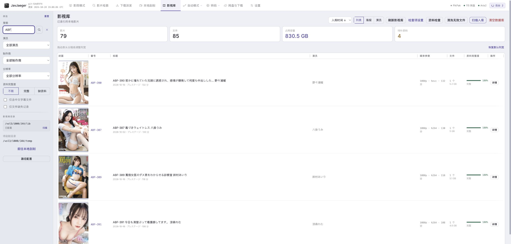

*搜索 ABF 后的 4 条影片记录，可查看媒体参数、体积与资料完整度。*

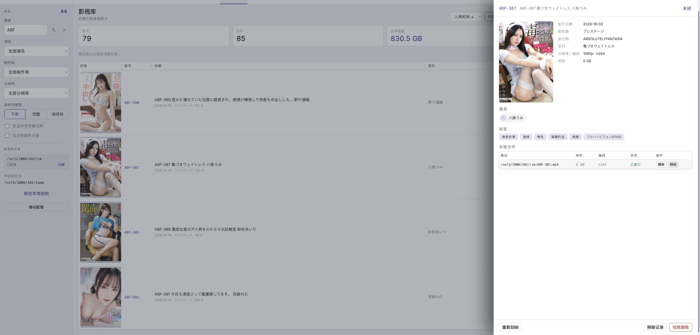

*影片详情展示文件路径与媒体信息，并提供播放和转码入口。*

</details>

### 移除、彻底删除与清洗

| 操作 | 对硬盘文件的影响 |
| --- | --- |
| 移除影片／清空影视库索引 | 保留媒体文件，只移除影视库记录及关联 |
| 彻底删除 | 永久删除该记录登记的视频及配套资料文件，再移除索引；操作不可撤销 |
| 清洗无效文件 | 只删除确认为零字节或经 ffprobe 确认不含视频流的文件，并更新索引 |

彻底删除受原扫描目录限制；磁盘不可访问或路径超出原扫描范围时会拒绝删除。清洗时，探测超时、读取失败或无法确认的文件会保留；ffprobe 不可用时不执行清洗。

## 本地刮削：整理媒体文件

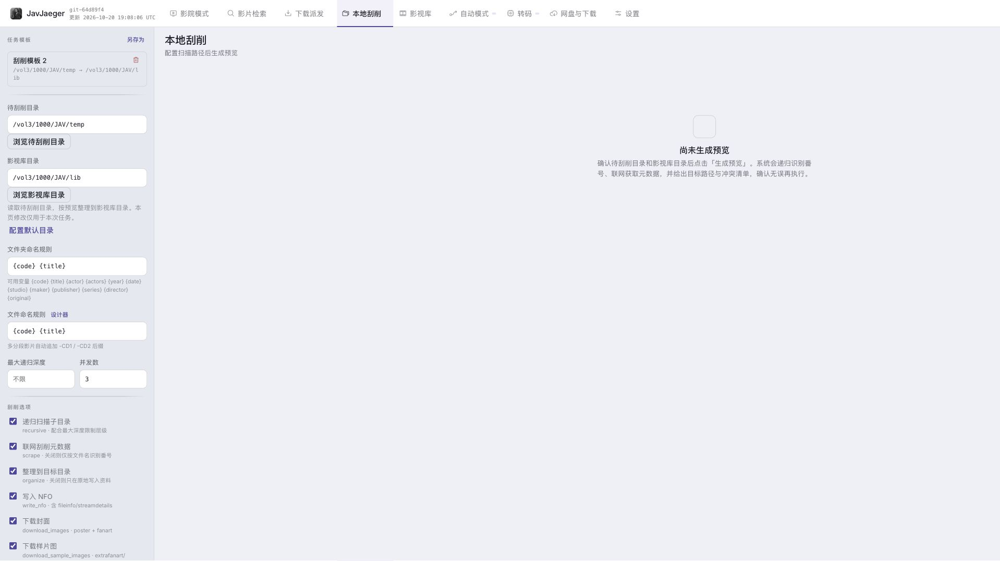

*先设置路径、命名规则和需要保存的资料，再生成预览。*

“刮削”是按番号获取影片标题、演员、标签、封面等资料，并将资料写到本地。生成的 NFO 文件可随视频一起保存，后续扫描时用于恢复影片信息。

1. 打开 **本地刮削**，确认待刮削目录和输出目录。页面默认使用已保存的媒体目录。
2. 选择是否递归扫描、是否整理到目标目录，以及文件夹和文件命名规则。
3. 按需开启写入 NFO、下载封面、样片、演员头像和列表缩略图；常用组合可保存为模板。
4. 点击生成预览，核对番号、目标路径、识别失败项和文件冲突。
5. 修正错误番号后重新预览；为冲突文件选择保留策略，或跳过不确定的项目。
6. 确认后执行，在后台任务和执行结果中查看逐文件成功、失败和入库结果。

**生成预览不会移动视频；执行整理会移动或替换文件。** 修改目录、命名规则或选项后，需要重新生成预览。多个源文件指向同一目标时，应先调整规则或移除重复项。

关闭“整理到目标目录”可在原目录写资料，不移动视频。在待刮削目录原地刮削不会自动加入影视库；整理到影视库目录后才自动入库。VR 影片整理时会归入目标根目录的 `VR/` 分区。

资料来源可在 **设置 → 刮削源** 中启用、调整优先级和测试。实际可用性取决于来源站点、网络与所需配置；某个来源失败时，先查看测试或任务结果，再调整来源。

<details>
<summary>查看刮削来源配置</summary>

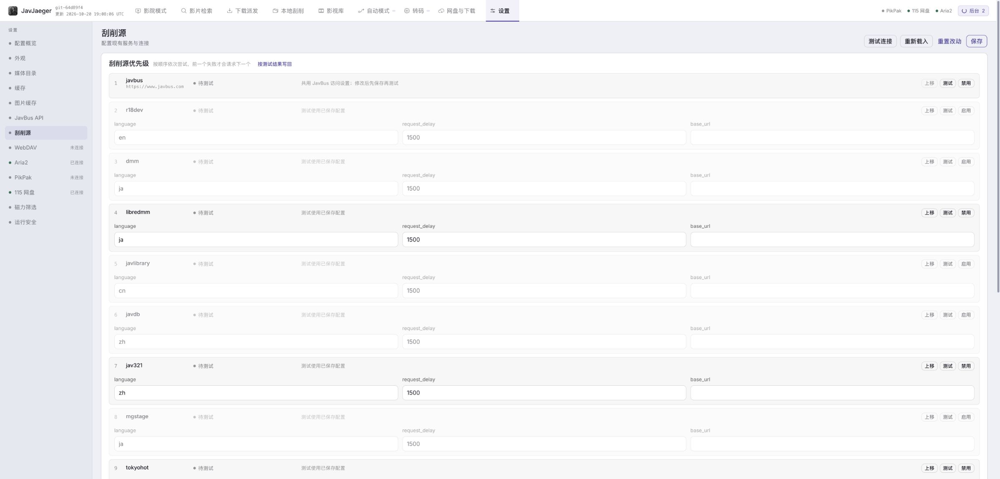

*刮削来源的优先级与启用状态。*

</details>

## 影片检索与下载派发

### 找影片和磁力

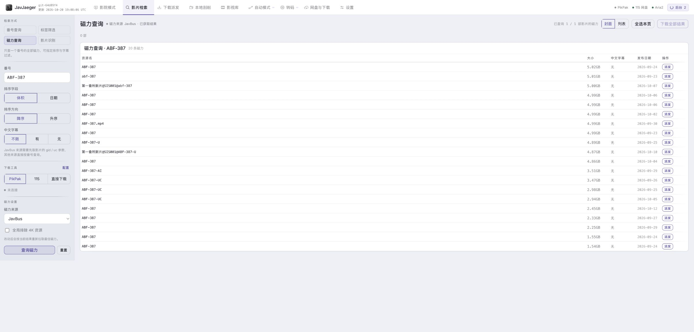

*磁力查询结果与资源选择入口。*

1. 打开 **影片检索**，选择 **番号查询、标签筛选、磁力查询** 或 **影片识别**。
2. 输入番号或组合筛选条件；演员、类别可从目录选择，也可输入目录中的名称或代码。直接点击“开始筛选”会应用当前输入；“添加为筛选条件”可用于组合多个条件。页面识别需要粘贴含影片条目的 HTML。
3. 选择 JavBus、Cilisousuo 或 YHG007 磁力来源，按需设置字幕筛选、排除 4K，以及排序方式。
4. 查看影片详情和资源列表，再派发单条资源，或勾选影片后批量派发。

标签筛选支持按页查看或获取全部结果。影片摘要先显示，演员等资料和磁力由后台继续补全；失败时可打开详情重试。切换来源后，资源数量和可用性可能不同。

类别目录包含 492 个不同代码，按 JavBus 有码类别页核对。同名类别可能对应不同代码；遇到名称歧义时，从目录选择具体条目或直接输入代码。筛选 VR 类别时，需取消“排除 VR 影片”。

### 连接下载工具

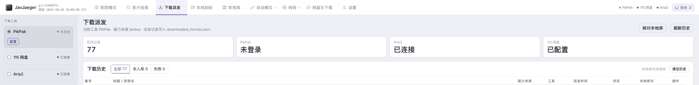

*下载工具连接状态与派发历史概览。*

| 工具 | 如何准备 | 提交后在哪里查看 |
| --- | --- | --- |
| PikPak | 在设置或下载工具配置中填写账号密码并登录，也可使用已保存的服务端配置 | PikPak 自身的离线任务与文件列表 |
| 115 网盘 | 扫码登录，或在设置中保存有效 Cookie；按需填写离线目录 CID | 115 网盘的离线任务与目录 |
| Aria2 | 填写服务器可访问的 JSON-RPC 地址和 RPC Secret，连接成功后使用 | 网盘与下载页面的 Aria2 任务区，或 Aria2 客户端 |

**下载派发** 页面可使用检索结果、选中影片或手工输入的番号列表。确认后，资源选择和提交在后台运行；115 大批量派发会分批等待，失败时按配置退避重试。

**“已提交”表示下载工具接收了任务，不等于下载完成，也不等于已入库。** 下载速度、资源是否存活、账号限制和配额由对应下载服务决定。

### 查看历史与处理失败

- 在 **下载派发** 页查看历史记录和失败项；失败资源可以重试，也可以忽略。
- 点击核对本地库，确认已提交的影片是否实际入库。未入库记录可重新选择资源并派发。
- 派发会检查本地影视库；已有影片跳过。成功提交过的资源链接用于去重，避免重复尝试同一链接。
- 清空下载历史也会清空已尝试链接，后续可能再次提交旧资源。

## 论坛影片：获取、筛选与下发

打开 **论坛影片**，或直接访问 `/#forum`。支持 98 堂（`dmn12.vip`）的 **亚洲无码原创** 与 **高清中文字幕** 分区。

1. 选择分区和页码，可先在“筛选本页标题”输入文字或番号，或点击 **LTX** 关键词，再点击 **获取影片**。后台读取列表后先匹配标题，只为匹配的普通影片帖补充图片、容量、演员与公开磁力；置顶公告会被排除。
2. 标题匹配不区分大小写，关键词和输入文字需同时满足；获取、翻页和 **刷新原帖** 都会携带当前条件。调整条件会立即筛选已显示的影片；扩大条件后需再次点击 **获取影片**，补充此前未读取的帖子。筛选只作用于所选列表页，其他页通过翻页获取。
3. 点击图片或标题查看帖子图片、原帖与磁力链接。图片通过受信任来源的图片代理加载，图片失败时仍保留标题与下发操作。
4. 选择已连接的 **PikPak、115 网盘或 Aria2**，单条下发，或勾选后 **下发所选**。切换筛选会移除被隐藏的选择，全选只包含当前筛选中资源已就绪的影片。

下发直接使用原帖提取的磁力，不按番号另行检索替换资源；连接配置、历史去重、任务与逐项结果复用现有下载流程。列表会显示当前目标的提交结果，成功项自动取消勾选，失败项保留选择以便重试。“已提交”仍表示下载工具接受任务，不表示下载完成或资源一定存活。

公开列表与帖子资料会缓存在 `data/forum_cache/`：默认列表有效期 **30 分钟**，帖子图片地址、演员、容量和磁力有效期 **24 小时**，总空间上限默认 **32 MB**，最多 **512 条记录**，超限清理最近最少使用的记录。缓存跨会话复用，服务重启后仍可读取；完整命中时不启动抓取浏览器，部分命中时只读取缺少的帖子。进入页面或切换分区会自动显示仍有效的完整缓存，界面显示列表更新时间；**获取影片** 优先使用缓存，**刷新原帖** 跳过缓存重新读取当前分区和页码。刷新失败会保留可用缓存，缓存损坏或磁盘不可写不会阻断正常抓取。图片文件继续复用独立的图片缓存，论坛缓存只保存图片地址。

在论坛页面点击 **缓存设置**，或打开 **设置 → 论坛缓存**，可调整列表缓存分钟数、帖子缓存小时数及容量上限（MB），均为正整数。保存后立即应用到已有记录，缩短时间或降低容量会清理过期或超限数据；延长时间不会找回已经清除的记录。页面显示当前缓存条数与占用空间，支持重新载入和重置未保存的改动。点击 **清空论坛缓存** 并确认后，仅删除已保存的论坛列表与帖子记录，保留缓存设置；图片缓存、下载历史、已显示的影片及运行中的任务不受影响，继续抓取可能产生新缓存。设置保存在 `data/forum_cache/settings.json`，所有设备共用并在重启后保留。

抓取任务按浏览器会话隔离，刷新页面或暂时离开后可恢复进度；可停止获取并保留已读取结果，重试只处理原任务条件下失败或未完成的帖子。任务状态仍在服务进程内存中；重启后可恢复有效的公开缓存，尚未抓取的部分需重新获取。缓存不保存原始 HTML、账号、Cookie、浏览器目录或下载工具状态。论坛不需要额外账号配置，站点安全验证或访问限制可能导致暂时失败；不会通过登录或回复来获取隐藏资源。未命中缓存的帖子串行读取，请求前等待 3 秒，初始安全验证检测窗口为 3 秒，读取前另等待 1 秒；实际出现验证时继续沿用 Scrapling 的处理流程及 90 秒导航/操作超时。

源码运行前需安装论坛使用的 Chromium，见下方 Mac 开发步骤；Docker 镜像会在构建时安装浏览器及系统依赖。

## 网盘与下载：把远程文件交给 Aria2

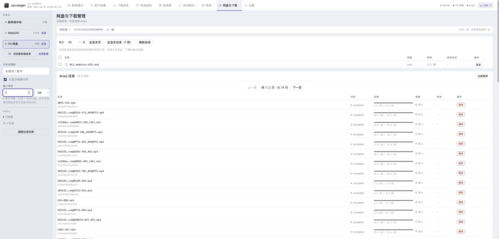

*115 网盘子目录使用“仅视频、最小 1 GB”筛选；下方为既有 Aria2 任务。*

1. 在设置中连接 WebDAV 或登录 115 网盘，并连接 Aria2。
2. 打开 **网盘与下载**，选择来源并进入目录。
3. 按需开启“仅视频”、设置最小体积，勾选文件或文件夹。
4. 确认发送到 Aria2，在后台任务中查看成功、失败和跳过项。
5. 在页面的 Aria2 任务区查看进度，暂停、恢复或移除下载任务。

文件夹会递归查找全部子目录，再对文件应用筛选。“全选本页”只选当前页，“全选本目录”选择当前筛选结果的全部分页；最小体积为 0 表示不限，1 GB = 1024 MB。

115 来源支持行内“删除”，也可勾选多项后点击“删除所选”。弹窗会列出待删除项目，确认后才提交；删除文件夹会包含其中的全部文件和子文件夹，不受当前视频或体积筛选限制。此操作无需连接 Aria2，完成后会刷新目录。若提示删除结果未确认，请先刷新核对，再决定是否重试。

“服务端本地”来源用于浏览服务器目录，不能发送到 Aria2。移除 Aria2 任务保留已下载文件。部分文件提交失败时，应只重试失败项，避免再次派发整目录。

WebDAV 和 Aria2 连接按浏览器会话隔离，换浏览器后需要重新连接。115 通过服务端 Cookie 解析文件地址；Cookie 不会作为下载地址内容或 Aria2 请求头下发。

## 自动模式：保存重复使用的流程

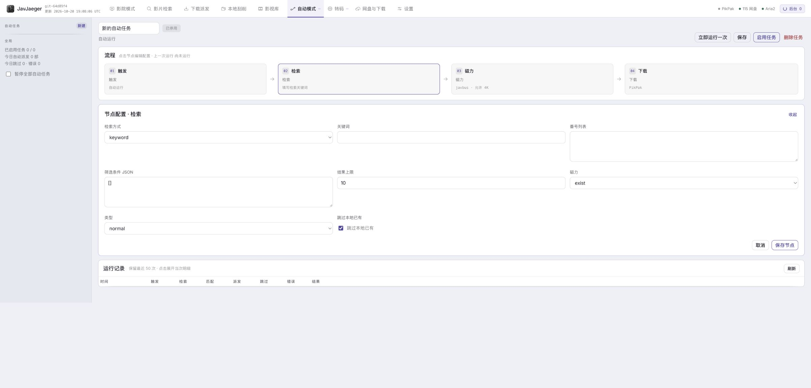

*按触发、检索、磁力和下载节点配置流程。*

1. 打开 **自动模式** 并新建任务，填写名称。
2. 配置检索节点：关键词、筛选条件或番号列表，以及结果数量上限。
3. 配置磁力节点：来源、字幕条件和是否排除 4K。
4. 配置下载节点，选择已准备好的 PikPak、115 网盘或 Aria2。
5. 保存并先手动运行，查看发现、命中、派发、跳过和失败明细。
6. 确认结果符合预期后，设置触发方式并启用任务。

| 触发方式 | 运行规则 |
| --- | --- |
| `auto` | 启用后自动执行一次；已有执行记录后不再重复安排 |
| `scheduled` | 每天在设置的 `HH:MM` 运行，按服务器时区计算 |
| `interval` | 按设置的分钟间隔重复运行 |

无人值守任务使用服务端已保存的下载工具配置。派发前检查本地库，并避开历史中已成功提交的资源链接。运行中不能删除任务；停用只关闭后续触发，已开始的执行仍会继续。

## GPU 硬件转码

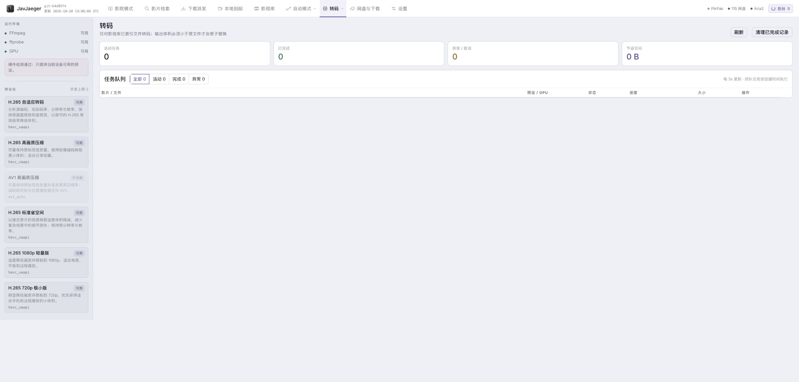

*硬件检测状态与转码任务队列。*

需要服务器具备 FFmpeg、ffprobe 和通过检测的 GPU 硬件编码器。Docker 镜像包含 FFmpeg，但显卡驱动和设备映射仍需按部署环境配置，见 [GPU 部署说明](DOCKER.md#1-配置-docker-composeyml)。

1. 在影视库中打开影片，选择要处理的本地文件并点击转码。
2. 等待硬件检测，选择 H.265 自适应、常用预设或专业参数。
3. 提交后进入 **转码** 页查看进度、速度、剩余时间与输出大小；可取消或重试失败任务。

<details>
<summary>查看单文件的硬件转码预设</summary>

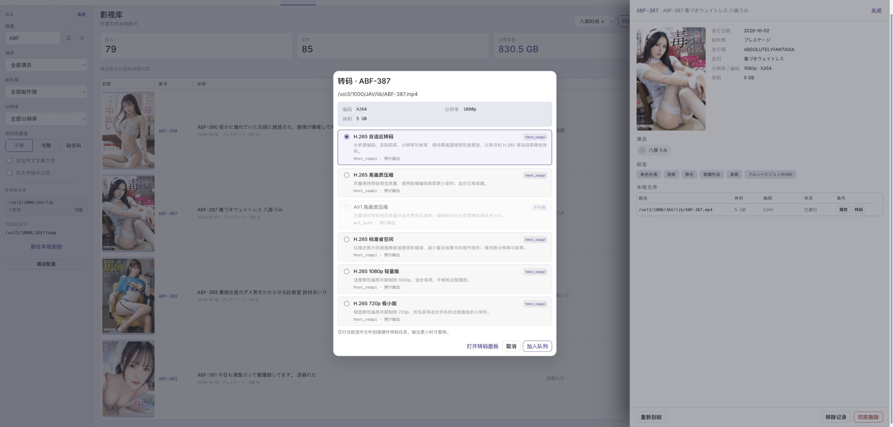

*选择硬件编码预设并查看输出参数。*

</details>

自适应模式依据源编码、实际码率、分辨率和帧率计算参数；源码率过低或已经采用同级、高效率编码时，可能拒绝重复有损转码。硬件不可用时不会回退到 CPU。

转码先写临时文件，只有输出通过视频流、时长、音轨等校验且**体积严格小于原文件**时才替换原片。输出没有变小、失败或取消都会保留原文件；成功后同步更新影视库媒体参数。

## 常见问题与维护

**检索或封面加载失败怎么办？**

先检查服务器能否访问对应来源。在 **设置 → JavBus API** 配置站点地址、请求超时和代理；刮削问题到 **设置 → 刮削源** 保存配置后测试。页面依赖 CDN 加载 React，页面无法初始化时也需要检查浏览器网络。

**配置后仍然没有可用的下载工具？**

检查对应设置是否已启用，必要字段是否填写，并实际执行连接或登录。Aria2 地址必须能从 JavJaeger 服务器访问；容器里的 `127.0.0.1` 指向容器自身。

**扫描不到媒体，或者播放时提示文件缺失？**

确认媒体磁盘已挂载、路径对服务端可见且权限正确。Docker 页面中应填写容器路径。外部移动或删除文件后，重新扫描相关目录；单纯刷新不会更新硬盘状态。

**刷新网页或重启容器会怎样？**

已创建的后台任务可在网页刷新或离开页面后继续执行。但搜索补全、单次派发、扫描和刮削等临时任务依赖当前服务进程，重启会中断，不能保证恢复。更新前先等待任务结束；中断后先核对文件、下载历史和下载工具，再重试。已保存的自动任务和转码记录会保留，中断的执行应检查状态后处理。

**如何更新和备份？**

更新前等待后台操作结束，停止应用，备份完整的 **`data/` 和 `actor_images/`**，并单独备份媒体目录。修改过配置路径或头像路径时，也要备份对应位置；不要只备份单个影视库 JSON，增量更新文件和演员索引需要一起保留。

拉取目标版本后重新执行 `docker compose up -d --build`。需要准确记录部署版本、回滚或迁移时，按 [部署 SOP](DOCKER.md#部署-sop) 操作。配置备份可能含账号、Cookie 和密钥，不要提交到公开仓库。

## 更多文档

- [Docker 部署、GPU 配置、反向代理与排障](DOCKER.md)
- [Android TV 安装和使用](android-tv/README.md)
- [工程流程与验证要求](docs/ENGINEERING.md)
- [贡献者约定与模块边界](AGENTS.md)

<details>
<summary>开发、源码运行与测试</summary>

### Mac 开发与测试

Mac 用于编辑、构建和隔离测试，部署服务运行在目标服务器。需要 **Python 3.11+、Node.js 20+**；本机无需 Docker、Aria2、真实账号或媒体挂载，也不需要为现有测试额外安装 FFmpeg。

首次在项目根目录执行：

```bash
python3 -m venv .venv
source .venv/bin/activate
python -m pip install -r requirements.txt
python -m patchright install chromium
npm ci
npx playwright install chromium --only-shell
```

无需复制或覆盖现有 `config.json`。每次新开终端后激活虚拟环境，再运行检查：

```bash
source .venv/bin/activate
npm run check
npm run test:browser
```

`check` 构建前端并运行前后端测试；浏览器回归使用临时配置、数据和独立端口启动后端，结束后关闭，不使用真实账号或媒体库。真实外部服务与 GPU 编码需要在目标部署环境验收。

### 源码运行

安装上述依赖后构建并启动；需要刮削媒体参数、清洗或转码时，系统还需安装 FFmpeg，并确保 `ffprobe` 可执行。

```bash
npm run build:frontend
uvicorn main:app --host 0.0.0.0 --port 8000
```

直接执行 `python main.py` 时监听 `5000`；macOS 可能占用该端口，使用上面的命令可指定 `8000`。

### 贡献与验证

遵循 [AGENTS.md](AGENTS.md) 的 Harness Engineering 与严格 TDD 流程。浏览器源码只编辑 `frontend/src/`，再构建生成 `static/app.js` 和 `static/app.css`；`templates/index.html` 保持为 HTML 外壳。

普通源码通过 `.gitattributes` 使用 LF，原始设计、归档和运行数据保留原始字节。后台变更可运行 `python -m pytest`；前端变更需重建，页面或交互变更还需运行 `npm run test:browser`。更多说明见 [工程文档](docs/ENGINEERING.md)。

</details>

## 许可证

本项目采用 MIT License。请遵守所在地法律法规及所使用服务的条款。
